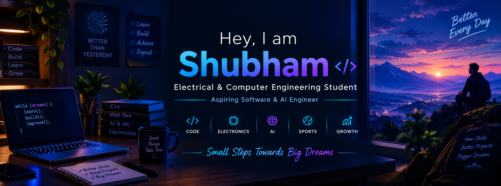

  

  <b>Electrical & Computer Engineering Student</b> 
  Exploring Software Development, Artificial Intelligence & Electronics

  
  
  

---

## 👨‍💻 About Me

Hey! I'm Shubham, an Electrical & Computer Engineering student at **ABES Engineering College** who enjoys technology, problem-solving, and learning by building.

- 🎓 Studying Electrical & Computer Engineering (ELCE).
- 💻 Currently learning and practising **C++ programming**.
- 🌐 Previously built projects using HTML, CSS, and JavaScript.
- 🤖 Interested in software development and artificial intelligence.
- ⚡ Curious about electronics and how hardware and software work together.
- 🎯 Focused on improving my skills through consistent practice and projects.
- 🌱 Believer in progress through patience, discipline, and curiosity.

  

## 🛠️ Tech Stack & Tools

### Languages

  
  
  
  

### Tools

  
  
  

---

## 🚀 What I'm Working On

- [x] Exploring web development with HTML, CSS, and JavaScript.
- [x] Creating and maintaining projects on GitHub.
- [x] Strengthening C++ fundamentals and problem-solving.
- [ ] Practising data structures and algorithms.
- [ ] Building more software projects.
- [ ] Exploring AI and machine learning fundamentals.
- [ ] Connecting my software knowledge with electronics.

---

## 📊 GitHub Analytics

  

---

## 🏆 Beyond Coding — Sports

Sports have taught me discipline, resilience, focus, and how to keep improving even when progress takes time.

- 🎾 **Lawn Tennis:** Played at the SGFI (School Games Federation of India) Nationals.
- 🌍 **Crossminton:** International-level playing experience.

I'm always open to opportunities to learn, compete, contribute, and prove myself through dedication and performance.

---

## 🎯 My Goals

- 📚 Build strong foundations in programming and engineering.
- 💡 Develop useful projects that solve real problems.
- 🤖 Grow towards software engineering and AI.
- 🤝 Connect with developers, students, and mentors.
- 🏅 Keep growing both technically and personally.

---

## 🤝 Opportunities & Collaboration

I'm at the beginning of my engineering journey, eager to learn from others and turn my ideas into real projects.

I'm open to:
- Beginner-friendly open-source contributions.
- Student projects and hackathons.
- Learning and building with fellow developers.
- Sports opportunities where I can demonstrate my ability and commitment.

If you have an interesting idea or opportunity, feel free to reach out!

---

## 📬 Let's Connect

  
  
  

---

  

<h3 align="center">✨ Thanks for stopping by! ✨</h3>

  Keep learning, keep building, and let's create something awesome together.

  <i>Learning consistently. Building purposefully. Improving every day. 🚀</i>

